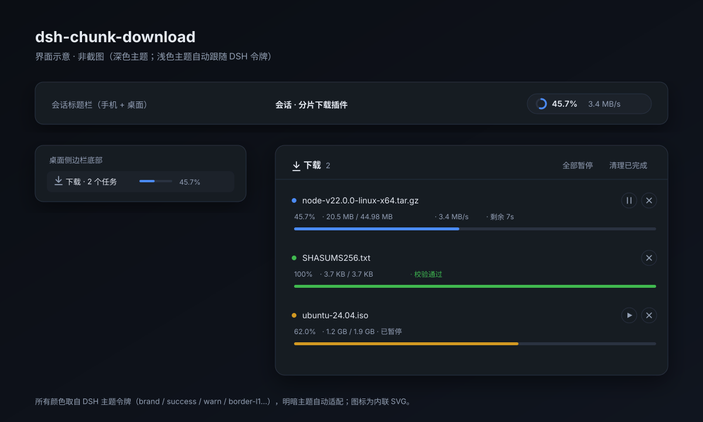

<div align="center">


# dsh-chunk-download

**A downloader for agents on your phone: parallel Range chunks, resume, and files that land straight in the phone's Download folder.**

[](.github/workflows/ci.yml)
[](LICENSE)


[中文](README.md) · Features · Install · Usage · [How it works](docs/how-it-works.md)

</div>

***

A [DeepSeek Harness](https://github.com/deepseek-ai/deepseek-harness) plugin that turns chunked Range downloading into agent
tools: N parallel connections, resumable chunks, pause/resume, rate limiting — several times faster than a single `curl`
connection. Runs on **Linux / macOS / Windows**; on Android it can also drop the file into `Download/DeepSeekHarness`.

> Parallelism does not help when a single connection already saturates the link. The win comes from servers that throttle
> per connection (cloud-drive direct links, some CDNs, GitHub Releases) — there it is routinely several times faster.

## Features

| | Feature | Notes |
| --- | --- | --- |
| 🚀 | Range chunking | 1–64 parallel `bytes=x-y` requests |
| ⏯ | Resume | completed-chunk bitmap + plan signature persisted on disk |
| ⏸ | Pause / resume / cancel | keeps `.part`, cancel can delete the file |
| 🧮 | Task queue | N concurrent tasks (default 2), the rest queue FIFO |
| 🐢 | Rate limit | token bucket, global and per task |
| 🛡 | Strict validation | `Content-Range` must match; byte counts must match; size changes rejected |
| 🔀 | Single-stream fallback | server ignores Range (200) or compresses the body ⇒ fall back, never write a corrupt file |
| 🕵️ | Stall watchdog | 30 s without data aborts and retries that chunk |
| 📊 | Live progress | progress bar, speed, ETA, chunk counts |
| 📱 | Export to phone | copies the finished file into `Download/DeepSeekHarness` through the DSH device bridge |
| 🔁 | Dedupe | the same URL + target reuses the existing task |
| 🖥 | Cross-platform | Linux / macOS / Windows, Node ≥ 20, no native deps |
| ✅ | SHA-256 verification | pass `sha256`; mismatch fails the task (optionally deletes the file) |
| 🗂 | If-exists policy | `overwrite` / `skip` / `rename` |
| 💽 | Disk preflight | refuses before starting when free space is short |
| 📦 | Batch downloads | `urls[]`, one result per entry |
| 🔔 | Completion notice | phone notification via the device bridge (desktop skips) |
| 📊 | Live UI | session-header chip, sidebar row and a floating task panel |
| 🧩 | Zero dependencies | Node built-ins only |

## Who is it for

- You ask the agent on your phone to fetch an installer / model / video / cloud-drive direct link and want it in `Download`.
- The server throttles **per connection** (cloud-drive links, some CDNs, GitHub Releases) — parallel connections help.
- You don't want to install aria2 or curl binaries (macOS, ARM servers, phone containers).

It is *not* for HLS/magnet/BT, nor for single connections that already saturate the link (parallelism then equals a single thread).

## Install

Build an npm-style tarball (`package/` prefix), install it from the DEEPSEEK_HARNESS plugin manager, enable
`chunk-download`, then start a new session:

```bash
rm -rf /tmp/tarpkg && mkdir -p /tmp/tarpkg
cp -a dsh-chunk-download /tmp/tarpkg/package
tar czf dsh-chunk-download-0.1.0.tgz -C /tmp/tarpkg package
```

The plugin also injects a short system-prompt section telling the agent to prefer `chunk_download` over `curl` for files.

## Cross-platform

| Platform | Download | Export to phone |
| --- | --- | --- |
| Linux / macOS / Windows | ✅ pure Node (`path`-based, Windows removes an existing target before rename) | — (no device bridge, skipped) |
| Android (DEEPSEEK_HARNESS) | ✅ | ✅ via the 3090 bridge into `Download/DeepSeekHarness` |

Without a device bridge, `export: true` is skipped and recorded as `exportError`; **the download itself is unaffected**.
CI runs the same tests on Ubuntu (Node 20/22/24), macOS (22) and Windows (22).

## UI



> Design mock, not a screenshot.

| Where | What |
| --- | --- |
| Session title bar (phone + desktop) | progress pill: ring + percent + live speed, `N tasks` when several |
| Desktop sidebar footer | `Download · N tasks` with a mini progress bar |
| Click either | floating panel / mobile bottom sheet: task list, speed, ETA, pause / resume / cancel, pause-all, clear-finished |

The panel polls `GET /chunk-download/tasks` (1 s while active, 4 s idle, paused when the page is hidden) and posts to
`POST /chunk-download/control`. Colours come from DSH theme tokens; icons are inline SVG.

## Usage

```jsonc
// chunk_download
{ "url": "https://example.com/big.iso", "connections": 16, "export": true, "waitMs": 60000 }

// chunk_download_status
{ "id": "dl_xxx" }                       // one task, or omit id for the whole queue

// chunk_download_control
{ "id": "dl_xxx", "action": "pause" }    // pause | resume | retry | cancel | remove | export

// chunk_download_wait
{ "id": "dl_xxx", "timeoutMs": 120000 }
```

Direct links often require identifying headers:

```jsonc
{ "url": "https://cdn.example.com/f.zip", "headers": { "referer": "https://pan.quark.cn/", "cookie": "..." } }
```

## Configuration

| Key | Default | Meaning |
| --- | --- | --- |
| `dir` | `~/Downloads` | default download directory |
| `connections` | `8` | default parallel connections (1–64) |
| `maxConcurrentTasks` | `2` | concurrent tasks |
| `speedLimit` | `0` | global rate limit in bytes/s (0 = unlimited) |
| `exportToPhone` | `false` | export every finished file to the phone |
| `autoResume` | `true` | resume unfinished tasks after a restart |
| `retries` | `4` | per-chunk retries |
| `requestTimeoutMs` | `20000` | probe / connect timeout |
| `stallTimeoutMs` | `30000` | idle timeout for a single request |
| `stateDir` | `$DSH_HOME/chunk-download` | task state directory |
| `promptSection` | `true` | inject the "prefer this plugin" system-prompt section |

## Benchmarks

> Measured 2026-10-25 on a home link against a domestic CDN, same file, same time window.

| Scenario | single connection | this plugin | Gain |
| --- | --- | --- | --- |
| 2 MB, local server capping **each connection** at 256 KB/s, 8 connections (`node bench/speedup.mjs 2`) | 8.34 s | **1.32 s** | **6.3×** |
| 44.98 MB real CDN (npmmirror), 8 connections, no throttling | 4.5–5.8 s (7.4–9.5 MB/s) | **2.1–2.3 s (18–21 MB/s)** | **≈2.4×** |
| same file while the CDN throttles per IP | 8–9 s | 8–9 s | ≈1× (per-IP cap) |

The gain is decided by the server: per-connection throttling ⇒ several times faster; a saturated single
connection or per-IP throttling ⇒ parity, never slower. 16 connections tripped npmmirror's rate limit in one
run (31 s for the same file that took 2.1 s with 8), so 8 is the safer default there.

## Development

```bash
git clone https://github.com/CXk253-chenxing/dsh-chunk-download.git
cd dsh-chunk-download
node --test                 # 16 tests, local HTTP servers only
node bench/speedup.mjs 2    # speed-up demo
```

## Limitations

- Direct links only — no cloud-drive share-link parsing, no HLS/DASH/magnet;
- servers without Range support can only be downloaded single-stream (no resume);
- very high connection counts may hit per-IP limits (429 / resets) — lower `connections`.

## Related plugins

| Project | Character | Pick it when |
| --- | --- | --- |
| [@leisureyu/dsh-smart-dl](https://github.com/LeiSureYu/dsh-smart-download) | bundles aria2, checksums, batch, panel | you want the mature aria2 engine on desktop |
| [dlx-downloader](https://github.com/zhanghuqqqq/dlx-downloader) | chunked curl engine, panel, mirror failover | you need mirror retries |
| [dsh-downloader](https://github.com/having5548/dsh-downloader) | download proxy with its own nodes | the route is blocked |
| **this project** | pure Node, 1–64 connections, phone export + notifications | phone / ARM / no binaries |

## License & Credits

Licensed under **AGPL-3.0-or-later**, matching [YunX](https://github.com/CYQawa/YunX), whose download kernel
(Kotlin, AGPL-3.0) inspired the chunk planning, `Content-Range` validation, single-stream fallback, token-bucket
rate limiting and sliding-window speed measurement used here.

Because the design follows YunX, the same copyleft applies: if you distribute a modified version or run it as a
network service, you must release your source under AGPL-3.0 as well.

Copyright (C) 2026 CXk253-chenxing — see [LICENSE](LICENSE).
